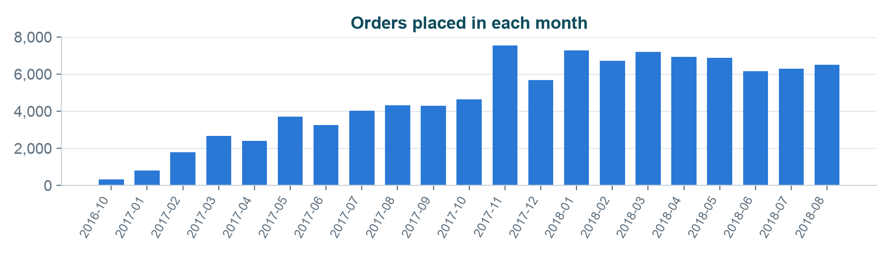
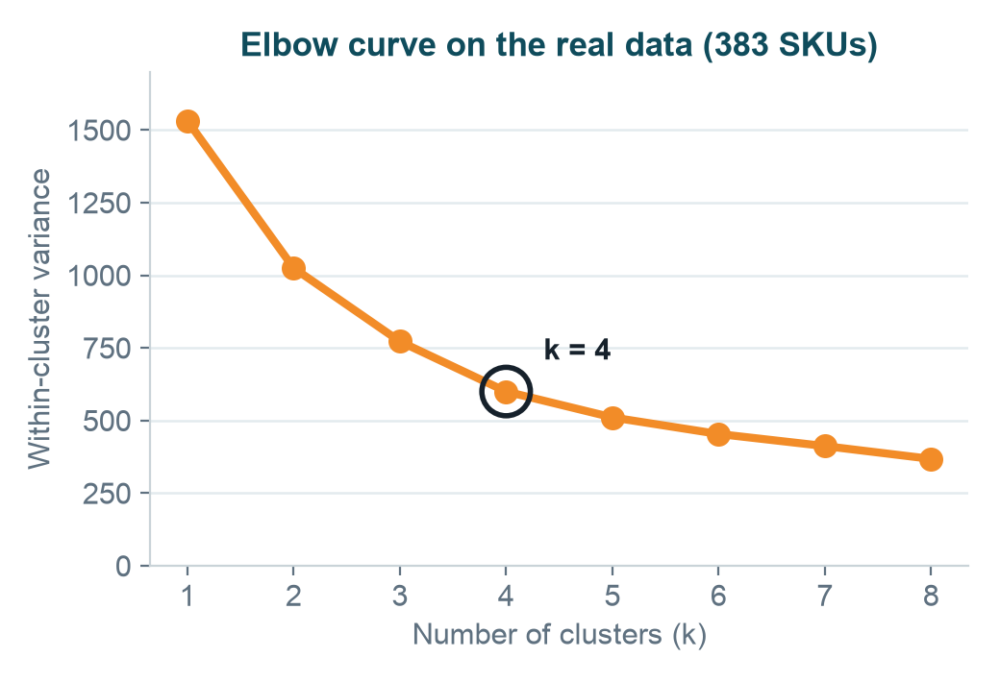
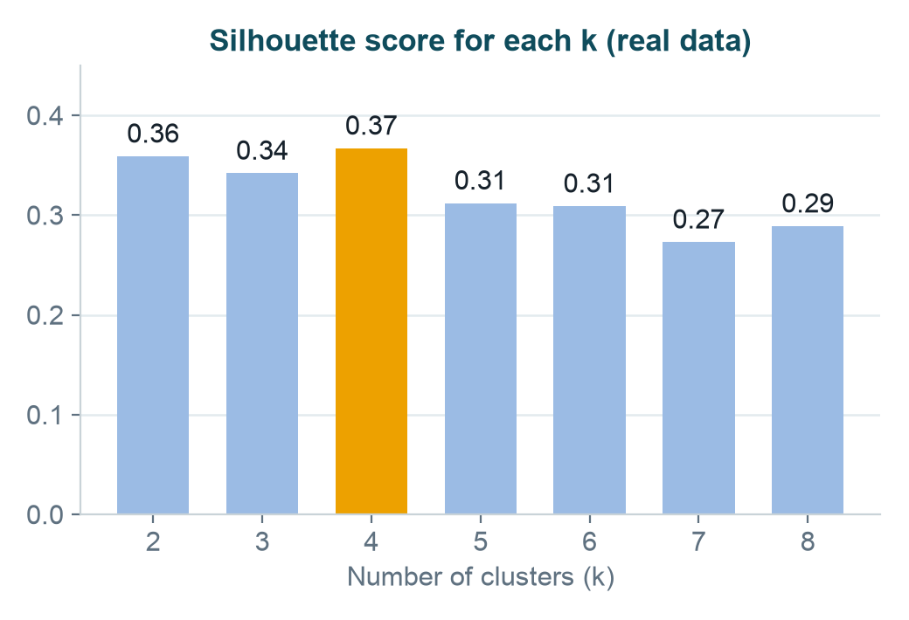
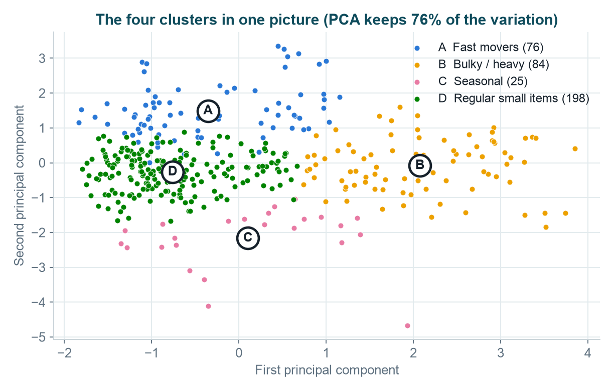
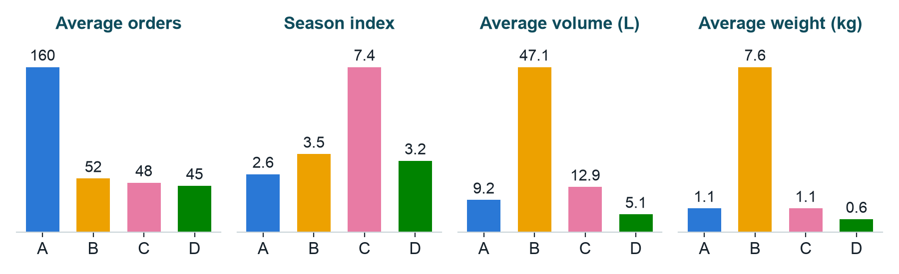
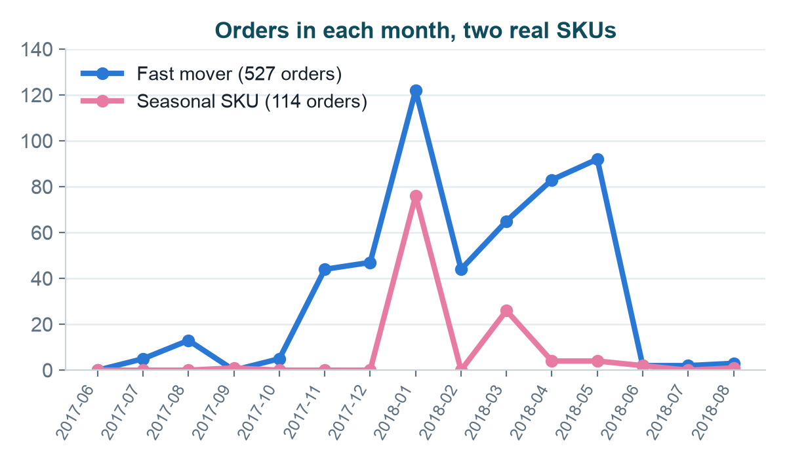
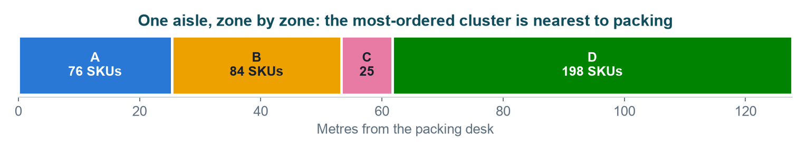
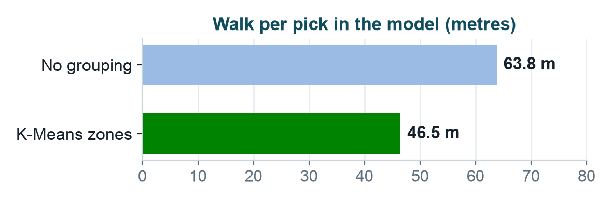

# Project documentation

**Grouping warehouse products with K-Means clustering**
Machine Learning (21CSC305P), Project Review 3, Team Cash guard

| What | Link |
|---|---|
| Live demo | https://zanyanbu.github.io/warehouse-sku-kmeans/ |
| Code, runs in Google Colab | [Open the notebook in Colab](https://colab.research.google.com/github/ZANYANBU/warehouse-sku-kmeans/blob/main/notebook/warehouse_sku_kmeans.ipynb) |
| Slides | [PDF](slides/kmeans-sku-clustering.pdf), [PowerPoint](slides/kmeans-sku-clustering.pptx) |
| Presentation script | [PDF](script/presentation-script.pdf) |
| Dataset | [Olist on GitHub](https://github.com/olist/work-at-olist-data/tree/master/datasets) |

## 1. The problem

A warehouse stores thousands of products. Each product type is called an SKU. When products are kept wherever there is space, workers walk a long way to collect each order.

The task: **partition the SKUs into groups of similar products**, using pick frequency, seasonal demand, physical size and handling needs, so that managers can place each group well and workers walk less.

## 2. The solution we chose

We reviewed the solutions in Unit 3 and chose **K-Means clustering**.

| Solution from Unit 3 | What it gives | Fit for this problem |
|---|---|---|
| **K-Means clustering** | k clear groups, one centre each | **Chosen.** Every SKU gets exactly one group, as it gets one place on a shelf. Simple and fast. |
| Mixture of Gaussians (EM) | A probability for every group | A product cannot sit 60% in one zone and 40% in another. |
| Hierarchical clustering | A tree of clusters | Compares every pair of items, so it gets slow for thousands of SKUs. |
| PCA / factor analysis | Fewer features | Makes no groups. We used PCA only to draw the clusters. |

## 3. The data

Real data: the **Brazilian E-Commerce Public Dataset by Olist** (MIT licence), read live from GitHub by the notebook.

- 99,441 orders placed from September 2016 to October 2018
- 112,650 order lines for 32,951 products
- We kept the **383 products ordered at least 30 times**, so that the seasonal number is not decided by two or three orders.

Each SKU is described by four numbers:

| Number | Meaning | Built from |
|---|---|---|
| `picks` | Pick frequency | count of order lines |
| `season` | Seasonal demand | share of orders in the busiest month, times 12 (1 = the same every month) |
| `volume` | Physical size, litres | length x height x width |
| `weight` | Handling, kg | product weight |

The dataset has no field for handling needs, so weight stands in for it. More detail is in [data/SOURCE.md](data/SOURCE.md).

## 4. The method

1. **Read** the three Olist files from the live link.
2. **Build** the four numbers for every SKU.
3. **Scale** them: take the log of the uneven columns (picks, volume, weight), then bring every column to the same scale.
4. **Choose k** with the elbow method, and check it with the silhouette score.
5. **Run K-Means** with the chosen k.
6. **Name** each cluster from its averages.
7. **Place** the clusters: the most-ordered cluster goes nearest to the packing desk.

## 5. Results

### Choosing k

The error falls by 33%, 25% and 22% up to k = 4, and then only by 15%. The curve bends at **k = 4**.

The silhouette score is also highest at k = 4 (0.37), so both checks agree.

### The four clusters

| Zone | Cluster | SKUs | Avg orders | Season index | Avg volume (L) | Avg weight (kg) | Where to place |
|---|---|---|---|---|---|---|---|
| A | Fast movers | 76 | 160 | 2.6 | 9.2 | 1.1 | Front racks, near packing |
| B | Bulky / heavy | 84 | 52 | 3.5 | 47.1 | 7.6 | Ground level, low racks |
| C | Seasonal | 25 | 48 | 7.4 | 12.9 | 1.1 | Flexible zone, moved forward in season |
| D | Regular small items | 198 | 45 | 3.2 | 5.1 | 0.6 | Back racks |

Every dot below is one real SKU. PCA squeezes the four numbers into two so they can be drawn; K-Means made the clusters.

The averages are how the clusters got their names: A is ordered the most, B is the biggest and heaviest, C has the highest season index, and D is small and steady.

### A seasonal product against a fast mover

Two real SKUs, month by month. The seasonal SKU had 76 of its 114 orders in a single month. The fast mover had 527 orders, with 40 or more in seven different months.

### Clusters become zones

Each cluster takes as much of one aisle as it has SKUs, and the most-ordered cluster comes first.

In this simple model the walk per pick falls from 63.8 m with no grouping to 46.5 m with the K-Means zones: **27% less**.

## 6. What we built

| Part | Where | What it is |
|---|---|---|
| Colab notebook | [`notebook/warehouse_sku_kmeans.ipynb`](notebook/warehouse_sku_kmeans.ipynb) | The whole method on the real data, with ten graphs. Uses pandas, scikit-learn and matplotlib. |
| Live demo website | [`index.html`](index.html) | Runs K-Means one round at a time in the browser, shows the elbow chart, and moves products on shelves under each Unit 3 solution. |
| Slides | [`slides/`](slides) | 18 slides: the problem, the choice of K-Means, the method and the real results. |
| Presentation script | [`script/`](script) | One page for each slide: what to say, a simple example, the terms and a likely question. |
| Data | [`data/`](data) | The 383 real SKUs with their four numbers and cluster, the result figures, and where the data comes from. |
| Build scripts | [`source/`](source) | The scripts that generated the slides, the graphs, the script PDF and the notebook. |

### How to run the code

1. Open the [notebook in Colab](https://colab.research.google.com/github/ZANYANBU/warehouse-sku-kmeans/blob/main/notebook/warehouse_sku_kmeans.ipynb).
2. Choose **Runtime > Run all**.
3. The notebook downloads the data, draws the graphs, prints the cluster table and saves `sku_clusters.csv`.

To run the demo website on your own computer, open `index.html` in a browser.

## 7. What is real and what is a model

- The orders, sizes and weights are **real data**.
- The **walking distance is a simple model** of one aisle: it shows why grouping helps, but it was not measured in a real warehouse.
- **Weight stands in for handling needs**, because the dataset has no handling field.
- The interactive part of the website uses **example products made up in the browser**; the "Tested on real data" section on the same page shows the real results.
- K-Means needs k chosen first, and a random start can end in a worse grouping, so it is run several times.

## 8. What could come next

- Use a warehouse's own data, with real handling labels.
- Measure the walking distance before and after in a real layout.
- Re-run the clustering each season, as demand changes.
